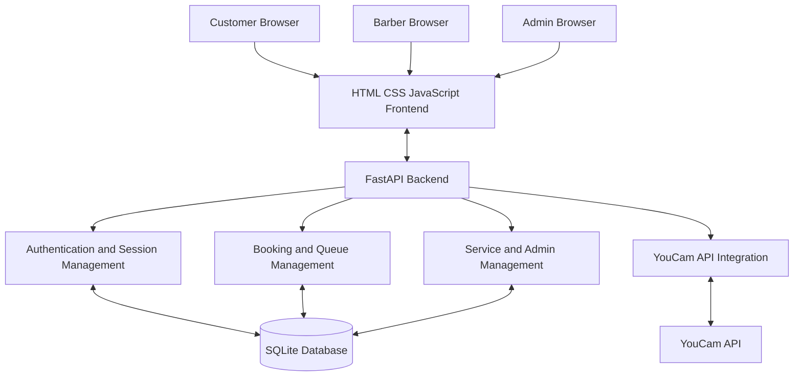
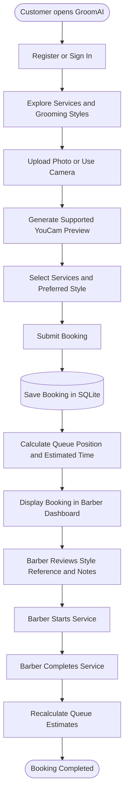

# GroomAI — AI-Powered Grooming & Smart Barber Queue

**Preview your look. Choose your style. Book your barber with confidence.**

GroomAI is a web-based grooming and barber-booking platform that combines YouCam AI virtual try-on capabilities with customer bookings, live queue estimation, and barber-side service management.

Instead of choosing a haircut or beard style based only on a reference photograph, customers can explore available styles, upload or capture their own photo, preview supported looks, and submit a booking with their preferred style attached. Barbers can then review the booking and reference information before providing the service.

GroomAI brings together **AI-powered grooming, appointment booking, queue management, and barber operations** in one application.

---

## Table of Contents

- [Project Overview](#project-overview)
- [Why GroomAI?](#why-groomai)
- [Features](#features)
- [Application Architecture](#application-architecture)
- [Customer-to-Barber Workflow](#customer-to-barber-workflow)
- [Technology Stack](#technology-stack)
- [Project Structure](#project-structure)
- [Getting Started](#getting-started)
- [Environment Configuration](#environment-configuration)
- [Application Pages](#application-pages)
- [AI Grooming Studio and YouCam Integration](#ai-grooming-studio-and-youcam-integration)
- [Smart Queue Estimation](#smart-queue-estimation)
- [Database Design](#database-design)
- [Authentication and Security](#authentication-and-security)
- [Testing the Application](#testing-the-application)
- [Troubleshooting](#troubleshooting)
- [Current Limitations](#current-limitations)
- [Future Improvements](#future-improvements)

---

## Project Overview

| Attribute | Details |
|---|---|
| Project name | GroomAI |
| Category | AI, Beauty Tech, Grooming, Web Application |
| Primary use case | Virtual grooming previews and barber booking |
| AI integration | YouCam API |
| Backend | Python, FastAPI |
| Frontend | HTML, CSS, JavaScript |
| Database | SQLite |
| Development environment | Windows 10/11 |
| Application type | Web application |

### The problem

Choosing a new hairstyle, beard trim, or moustache style can be difficult when customers cannot visualize how the result might look on them.

Traditional barber appointments often depend on reference photographs and verbal explanations. Customers may struggle to communicate their expectations, while barbers must interpret those preferences during consultation.

### Our solution

GroomAI connects visual style exploration with the actual barber-booking process.

Customers can browse grooming styles, use supported YouCam virtual try-on functionality, select a preferred look, and submit a booking. The barber receives the booking with available style references and customer instructions.

The goal is to make grooming decisions more informed, consultations clearer, and the booking experience more convenient.

---

## Why GroomAI?

Most grooming experiences separate style inspiration from the actual service appointment.

GroomAI connects the two.

**For customers**
- Explore styles before visiting the barbershop.
- Compare available hairstyle, beard, and moustache options.
- Use a personal photo for supported AI previews.
- Include style preferences in a booking request.
- Follow booking status and estimated service times.

**For barbers**
- View online bookings and walk-in customers in one queue.
- Review customer style references and instructions.
- Manage service progress and queue order.
- Estimate waiting times based on current service status.

**For shop administrators**
- Manage services, pricing, and estimated durations.
- Monitor daily bookings and queue activity.
- View customer accounts and operational statistics.

---

## Features

### 1. Customer Portal

The customer portal provides the main grooming and booking experience.

- Customer registration and login.
- Username, password, phone number, and profile emoji.
- Optional Google sign-in when configured.
- Browse available services and packages.
- View service prices and estimated durations.
- Select multiple services in a booking.
- Browse hairstyle and facial-hair style galleries.
- Upload a personal photo or use browser camera access where supported.
- Generate AI previews for supported styles when the YouCam integration is configured.
- Attach style preferences and reference information to a booking.
- View booking status, queue number, estimated service start, and suggested arrival time.
- Receive updated queue estimates through periodic polling.

### 2. AI Grooming Studio

GroomAI integrates YouCam API functionality for supported virtual grooming experiences.

- Browse official YouCam hairstyle templates when available.
- Explore beard and moustache templates.
- Select a template for a supported AI preview workflow.
- Upload a photo for virtual try-on.
- View the generated preview when the API request succeeds.
- Preserve the requested style and available preview reference in the booking workflow.

The dedicated AI Studio is available at `/studio`. Style exploration is also integrated into the customer booking experience.

**Important:** Template retrieval and AI preview generation are separate operations. Official template availability and preview generation depend on API credentials, endpoint access, and successful responses from YouCam.

### 3. Barber Workspace

The barber workspace helps staff manage customer appointments and walk-in services.

- Dedicated barber login.
- View the active service queue.
- Review recent booking activity.
- Add walk-in customers to the shared queue.
- Start a service.
- Complete a service.
- Skip a late customer.
- Mark a customer as a no-show.
- Requeue skipped or no-show customers.
- Review available customer style references and booking instructions.

Online bookings and walk-ins use the same queue, allowing the barber to manage them together.

### 4. Admin Workspace

The admin workspace provides basic shop management.

- Dedicated admin login.
- View daily booking counts.
- Monitor waiting, in-service, and completed bookings.
- View a completed-service revenue estimate.
- View customer accounts.
- Add and edit services or packages.
- Change service names, prices, durations, and active status.
- Manage queue status through the dashboard.

### 5. Smart Queue Estimation

GroomAI calculates approximate service start times using service durations and queue order.

The system updates estimates when the barber starts or completes a service, helping customers understand the expected wait.

These times are estimates rather than guaranteed appointment times.

---

## Application Architecture

The following diagram illustrates the major application components and their relationships.



### Architecture explanation

**Frontend**

The frontend provides the customer, barber, and admin interfaces using HTML, CSS, and JavaScript. It handles forms, style selection, photo uploads, dashboard updates, and communication with the backend.

**FastAPI backend**

The Python backend serves application pages and API endpoints. It coordinates authentication, booking operations, queue calculations, administrative actions, and AI integration.

**Authentication and sessions**

Customer, barber, and admin access are separated by role. The backend checks permissions before allowing protected operations.

**Booking and queue management**

The booking component stores customer requests, selected services, service statuses, and available style-reference information. It recalculates estimated start times when queue statuses change.

**YouCam integration**

The AI integration communicates with YouCam endpoints for supported template retrieval and virtual try-on operations. API credentials remain on the backend rather than being embedded in frontend JavaScript.

**SQLite database**

The database persists customer accounts, staff accounts, services, and booking information.

---

## Customer-to-Barber Workflow

This diagram illustrates the intended end-to-end booking journey.



The AI preview is optional for the booking flow. Customers can still use the booking features without a successful YouCam preview.

The exact details shown to the barber depend on which style references and preview information were successfully saved with the booking.

---

## Technology Stack

| Technology | Purpose |
|---|---|
| Python | Backend application logic |
| FastAPI | HTTP routes and API endpoints |
| HTML | Page structure |
| CSS | Layout, styling, and responsive presentation |
| JavaScript | Frontend interactions and API requests |
| SQLite | Persistent application data |
| YouCam API | Supported grooming template and virtual try-on functionality |
| Google Identity Services | Optional Google sign-in |
| Uvicorn | ASGI application server |

The application is designed to run locally on Windows without requiring Docker.

---

## Project Structure

The following is a conceptual overview. Exact files may vary by project version.

```text
GroomAI/
├── main.py                  # FastAPI application and routes
├── booking_extension.py     # Booking and queue functionality, if separated
├── requirements.txt         # Python dependencies
├── run.bat                  # Windows startup script
├── .env.example             # Example configuration
├── .env                     # Private local configuration
├── groomai.db               # SQLite database, created at runtime
├── static/
│   ├── styles.css           # Application styles
│   ├── customer.js          # Customer interactions, if present
│   └── barber.js            # Barber interactions, if present
├── templates/               # HTML templates, if used
└── README.md
```

Keep your actual project structure as the source of truth. Remove any example entries above that do not exist in your checked-out version.

---

## Getting Started

### Prerequisites

Install the following:

- Windows 10 or Windows 11.
- Python 3.11 or another Python version supported by the project's dependencies.
- A modern browser such as Chrome or Edge.
- A YouCam API key for the official template and AI preview functionality.
- A Google OAuth Web Client ID only if Google sign-in is required.

### 1. Download the project

Extract the project into a convenient directory, for example:

```text
D:\GroomAI
```

Open PowerShell in that directory.

### 2. Create a virtual environment

```powershell
py -3 -m venv .venv
```

### 3. Activate the virtual environment

```powershell
.\.venv\Scripts\Activate.ps1
```

If PowerShell blocks script execution, use the appropriate execution policy for your environment or run the application through the supplied `run.bat` file.

### 4. Install dependencies

```powershell
python -m pip install --upgrade pip
pip install -r requirements.txt
```

### 5. Configure environment variables

If `.env` does not exist, copy the example file:

```powershell
Copy-Item .env.example .env
```

Open the file:

```powershell
notepad .env
```

Add your configuration values.

If `.env` already exists, do not overwrite it. Update only the required variables so you preserve your existing private configuration.

### 6. Start GroomAI

You can use the included startup script:

```powershell
.\run.bat
```

Alternatively, run the backend directly:

```powershell
python -m uvicorn main:app --reload --port 8000
```

### 7. Open the application

Navigate to:

```text
http://127.0.0.1:8000
```

The application should display the GroomAI landing page.

---

## Environment Configuration

### YouCam configuration

The AI grooming features require valid YouCam API credentials and the relevant endpoint permissions.

Example:

```dotenv
YOUCAM_API_KEY=your_actual_api_key
YOUCAM_API_BASE=https://yce-api-01.makeupar.com
```

Use the actual variable names expected by your current code and `.env.example`.

Keep the API key private. Never place it directly in frontend JavaScript, commit it to GitHub, or expose it in public logs.

After changing `.env`, restart the application.

### Google sign-in configuration

Google sign-in is optional.

1. Open the Google Cloud Console.
2. Configure an OAuth client with the Web application type.
3. Add your local origin to the authorized JavaScript origins.
4. Set the client ID in `.env`.

Example:

```dotenv
GOOGLE_CLIENT_ID=your-client-id.apps.googleusercontent.com
```

Restart GroomAI after changing the configuration.

Google sign-in verifies the identity token against the configured client ID. Google-created customers must provide a phone number when required by the booking flow.

The current MVP stores the phone number but does not send an SMS OTP for phone ownership verification.

---

## Application Pages

| Route | Purpose |
|---|---|
| `/` | Landing page |
| `/customer/signup` | Customer registration |
| `/customer/login` | Customer sign-in |
| `/customer` | Customer booking dashboard |
| `/barber/login` | Barber sign-in |
| `/barber` | Barber queue workspace |
| `/admin/login` | Admin sign-in |
| `/admin` | Admin dashboard |
| `/studio` | AI grooming studio |

All routes should be checked against the current application implementation if route names change in a later version.

---

## AI Grooming Studio and YouCam Integration

YouCam provides the external AI functionality used by GroomAI's supported grooming workflows.

### Template retrieval

The application requests available grooming templates from the backend. When the configured YouCam account has access to the relevant endpoints, the application can display official hairstyle and facial-hair template information returned by the service.

A template can include fields such as:

- Template identifier.
- Template name.
- Image URL.
- Category or group metadata.
- Other metadata supplied by the endpoint.

The customer interface uses this information to display the available styles.

### Virtual try-on

The intended virtual try-on flow is:

1. The customer selects a supported style.
2. The customer uploads a compatible photo or captures one using the browser camera.
3. The application submits the necessary information to the backend.
4. The backend communicates with the appropriate YouCam endpoint.
5. The application displays the generated preview when the request succeeds.
6. Available style and preview references can be included with the booking.

The API key stays on the backend.

### Image handling

Official template images and AI-generated previews are different assets.

- A template image illustrates the available style.
- An AI-generated preview represents the result of a supported try-on operation.
- A customer reference photo is the input used for the preview or booking.
- A generated preview URL should only be shown as a generated result when it actually comes from a successful AI operation.

The application should handle missing templates, failed requests, and unavailable preview results without preventing customers from using the ordinary booking functionality.

### Troubleshooting YouCam

If official templates do not appear:

1. Check `YOUCAM_API_KEY`.
2. Check `YOUCAM_API_BASE`.
3. Restart the application after updating configuration.
4. Check the backend response from the relevant template endpoint.
5. Verify that the YouCam account has access to the required endpoints.
6. Inspect template IDs and image URLs returned by the API.

If templates appear but previews fail, check the preview-generation endpoint and its response separately. Successful template retrieval does not guarantee that virtual try-on generation is available.

---

## Smart Queue Estimation

GroomAI uses service durations and queue order to calculate estimated service start times.

### Queue calculation concept

For each waiting customer, the application estimates the service start time using the remaining duration of any service currently in progress, followed by the durations of earlier customers in the waiting queue.

Conceptually:

```text
Estimated start time
    = Current time or current service finish time
    + Durations of customers ahead in the queue
```

If a customer selects multiple services, their estimated service duration is based on the combined durations of those services.

### Suggested arrival time

The application normally suggests arriving approximately 10 minutes before the estimated service start, without suggesting a time earlier than the current time.

### Queue status updates

The barber can update a booking's status, including:

- Waiting.
- In service.
- Completed.
- Skipped.
- No-show.

When the queue changes, the application recalculates estimates so that customers can receive updated information through the booking dashboard.

### Important limitation

Queue estimates are not guaranteed appointment times. Actual service durations may differ from estimates because of consultation time, customer preferences, delays, or other operational factors.

The current MVP uses a shared queue. It does not implement advanced scheduling across multiple barbers, shop opening hours, multiple branches, or travel-time calculations.

---

## Database Design

GroomAI uses SQLite to persist application information in `groomai.db`.

The primary data areas include the following.

| Data area | Purpose |
|---|---|
| Customer accounts | Customer identity and login information |
| Staff accounts | Barber and admin login information |
| Services | Service names, prices, durations, and active status |
| Bookings | Customer requests, selected services, and booking status |
| Queue information | Information needed to organize waiting and active services |
| Style references | Available requested-style and preview information associated with bookings |

The exact table names and relationships are defined by the application's database implementation.

### Data persistence

The SQLite database remains on disk when the server is restarted. For a local installation, keep the existing `groomai.db` file when installing application updates if you want to retain customer accounts, services, and bookings.

Before making database changes or moving to production, create a backup.

---

## Authentication and Security

GroomAI separates customer, barber, and admin access.

### Authentication

- Customers register and sign in through the customer portal.
- Barbers use a dedicated barber login.
- Administrators use a dedicated admin login.
- Protected operations should check the account's role before allowing access.

### Password and session handling

According to the current project documentation:

- Passwords are stored as salted PBKDF2 hashes rather than plaintext.
- Login sessions are signed and stored in an HTTP-only cookie.
- Session configuration is controlled by environment variables.

### Local demo credentials

The following defaults are documented for local testing, if created by your current application version.

**Barber portal**

```text
Username: barber@groomai.local
Password: Barber@12345
```

**Admin portal**

```text
Username: admin@groomai.local
Password: GroomAI@12345
```

Login pages:

- Barber: `http://127.0.0.1:8000/barber/login`
- Admin: `http://127.0.0.1:8000/admin/login`

These credentials are for local testing only. Change the credentials before deployment and verify whether previously created staff accounts remain active in the database.

### Production security recommendations

Before exposing GroomAI publicly:

- Set a long, randomly generated `GROOMAI_SESSION_SECRET`.
- Change all default staff credentials.
- Keep `.env` out of source control.
- Use HTTPS.
- Set `COOKIE_SECURE=1` when serving the application over HTTPS.
- Add rate limiting and protections against repeated login attempts.
- Implement email or phone verification if required by the service.
- Configure database backups and recovery procedures.
- Review image storage, access permissions, retention, and deletion.
- Perform a security review before handling real customer data.

The current MVP does not implement all of these protections and should not be treated as production-hardened.

---

## Testing the Application

Use the following manual test plan after installing or updating GroomAI.

### Customer workflow

1. Open the landing page.
2. Register a customer account.
3. Sign in.
4. Browse available services.
5. Explore the hairstyle and facial-hair galleries.
6. Test photo upload and camera access where supported.
7. Try the virtual preview if YouCam is configured.
8. Submit a booking.
9. Check the booking status and queue estimate.

### Barber workflow

1. Sign in using the barber account.
2. Confirm that the customer booking appears in the queue.
3. Inspect the requested style, notes, and available reference information.
4. Start the service.
5. Complete the service.
6. Verify that the queue estimates update.

### Admin workflow

1. Sign in using the admin account.
2. Inspect the dashboard statistics.
3. Add or edit a service.
4. Update a service's price or duration.
5. Verify that the customer portal reflects the active services.

### Persistence test

1. Create a booking.
2. Restart the server.
3. Sign in again.
4. Confirm that the booking and account still exist.

### YouCam integration test

1. Confirm that the template endpoint returns the expected template data.
2. Verify that the correct image appears for each template.
3. Submit a compatible photo to a supported try-on operation.
4. Confirm that the generated result is returned and displayed.
5. Verify that the booking retains the selected style and available preview reference.

A successful page load alone does not establish that the complete AI integration works.

---

## Troubleshooting

| Problem | What to check |
|---|---|
| `401 Please sign in` | Sign in through the appropriate portal |
| `403 This account does not have permission` | Verify that you are using an account with the required role |
| Google sign-in button is missing | Configure `GOOGLE_CLIENT_ID` and restart the application |
| Staff login fails | Check the environment variables and any previously created staff accounts |
| YouCam templates are missing | Check the API key, base URL, endpoint access, and backend response |
| YouCam preview fails | Check preview-generation credentials, supported inputs, and endpoint errors |
| Images appear incorrectly | Inspect the actual image URL returned for each template and review the image display styling |
| Camera access fails | Use localhost or HTTPS and allow camera access in the browser |
| Queue estimates seem incorrect | Check service durations, queue order, and current service status |
| Existing accounts disappear after an update | Confirm that the application is using the original `groomai.db` file |

---

## Current Limitations

GroomAI is an MVP intended to demonstrate an integrated grooming and booking workflow.

Current limitations include:

- Queue estimates are approximate, not guaranteed appointment times.
- The queue uses a single shared service line.
- Google sign-in is optional and requires configuration.
- Phone numbers are stored without SMS OTP verification.
- YouCam features require valid credentials and endpoint access.
- Template retrieval and AI preview generation may fail independently.
- Email verification and password recovery are not implemented in the current MVP.
- Production-grade rate limiting and a complete security review remain necessary.
- Multi-barber scheduling, multiple branches, payments, SMS notifications, and travel-time calculations are not included.

These limitations are important when evaluating the current application's capabilities.

---

## Future Improvements

Potential future development includes:

### Personalized grooming recommendations
Recommend styles based on customer preferences and previous selections.

### Improved virtual try-on
Expand supported grooming styles and improve the experience for different photos and lighting conditions.

### Multi-barber scheduling
Support multiple barbers with individual availability, service durations, and appointment calendars.

### Notifications
Send booking confirmations, queue updates, and appointment reminders through a trusted notification provider.

### Booking and payment integration
Add online deposits, service payments, receipts, and cancellation policies.

### Customer grooming profiles
Allow customers to save favorite styles, previous bookings, and reference photos.

### Production readiness
Add stronger security protections, monitoring, backup automation, and deployment configuration.

---

## Privacy and Responsible Use

GroomAI may process customer photographs for virtual try-on and style-reference purposes.

Users should be informed about how their images are used, where they are processed, and how long they are retained. Only collect the information required to provide the service, protect stored data, and provide a clear deletion process before launching publicly.

AI-generated grooming previews are visual references, not guarantees of the final haircut or beard trim. The customer and barber should confirm the desired style before the service begins.

---

## Conclusion

GroomAI brings together AI-powered grooming exploration and practical barber-shop operations.

By connecting style discovery, supported virtual try-on, customer booking, queue estimation, and barber-side service management, the project demonstrates how AI can become part of a real service workflow rather than remain an isolated demonstration.

**GroomAI — Find your look. Preview your style. Book with confidence.**

---

## License

Add your chosen open-source license here if you intend to distribute the project publicly. Do not claim a license until the corresponding license file and terms have been added to the repository.
